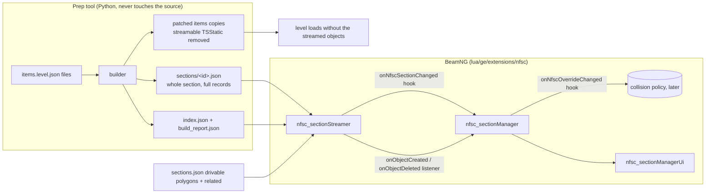

# Palmont section streaming: architecture

Streaming decides which base objects exist. The section manager decides which overrides are
visible. They are two engine extensions with a small interface and can be tested separately.

## Streamer (`nfsc_sectionStreamer`)
- Camera X/Y -> section: bounding box + ray cast against drivable polygons, else closest edge
  within 0.1 (ties to the lower ID), else no section. Outside every section nothing is wanted.
- Wanted set = current section + its `related` sections.
- Entering a section: its whole file is read (current section first, one file per frame) into a
  per-section PENDING list: terrain-like objects (`IdentityMatrix` / `ChoppedRoadway`) first, then
  the rest, each grouped by `shapeName`. Pending records are fed into the load queue, which is
  capped at `maxQueuedItems`: terrain of every active section first, current section before its
  related ones. Objects are created from that queue (count and millisecond budget per frame) and
  re-checked right before creation. An object in several sections is created once (shared
  `__streamKey`). Every placement is still created individually (no merging, no dedup by mesh, no
  `dynamic`), so BeamNG's own static batching keeps working.
- Look-ahead (as in the game's TrackStreamer): the smoothed camera velocity gives a point
  `min(1.5 s, 100 m)` ahead (none below 1 m/s or above 178.81 m/s, which is treated as a jump). When that
  point lies in another section for `predictionStableTime` (0.25 s), that section becomes the current one
  before the camera crosses the border; the status shows `cameraSectionID` and `predictedSectionID`.
  The game restricts this to authored STREAMER_PREDICTION zones (section numbers in `data[4]`); we do
  not have those zones in `sections.json` yet, so it applies everywhere. `predictionEnabled = false`
  turns it off. Hooks and the manager see the predicted section as the current one.
- Load order: related sections are fed in the game's three priority bands (distance of the point one
  second ahead outside the section, reduced when heading towards it, 75 m bands), the static related
  order breaks ties, the current section is always first. Refreshed every 0.5 s (`getLoadOrder()`).
- Frame budget (0008): one `frameBudgetMs` for the whole frame. Deletes run first and may use
  `deleteBudgetShare` of it; creates get what is left. A new shape (first use, 8-14 ms measured) is the
  expensive create: at most `maxFirstUsePerFrame` per frame, and a new shape is not started when the
  expected first-use cost no longer fits in the remaining budget (it stays at the head of the queue).
  The first create of a frame is always allowed, so a tiny budget still makes progress. The queue is
  grouped by shape, so a frame is typically one new shape plus its cheap repeat instances.
- Timing: `getStatus()` reports average and maximum create time, first-use versus repeat shape
  creates, section read time, per-frame load time (last and peak) and seconds until the last section
  change settled. Since 0008 the numbers that matter are per section change (`change*` fields, reset at
  every change) and `logSettle` prints three lines per settled change: objects, seconds, objects/s,
  frames, fps and worst frame while loading, streaming ms per frame; create totals split into first
  use (shape never created this session), reload (created before, but no live instance at that moment:
  the engine may have freed it) and warm (a live instance exists); the five most expensive shapes
  (`top N:` lines, with first/reload counts); and the cost split of one create (createObject, setField
  loop, registerObject, group add) plus deletes. Measured in game: registerObject is practically the
  whole create cost, group add is not a factor. The deferral of a new shape uses a moving average of
  the latest first-use creates, not the session average. The session-wide averages in `getStatus()` are cumulative and hide changes.
- Section change: queue entries and pending data no active section needs are dropped at once
  (`staleDiscarded`), order is preserved, `queuedKeys` is rebuilt, so new work never waits behind
  stale records.
- Create filter (`setCreateFilter(fn)`): `fn(item) == false` holds an object back. Held-back items
  stay in a per-section deferred list while the section is active; `refreshFilter()` queues the ones
  now accepted (and cancels a pending unload of one that is still alive), `releaseObject(key, item)`
  deletes a live object after the cooldown and holds it back again.
- Leaving a section: objects no other active section needs are deleted after the cooldown; coming
  back inside the cooldown cancels the deletion.
- All objects live in one runtime SimGroup, `NFSC_StreamedScenery`, deleted and rebuilt on every
  initialize/reset, so a Lua reload can never leave duplicates behind.
- Transforms are written as exported (`position`, `rotationEuler`, `scale` as space-joined text via
  `setField`, like every other field). Nothing is converted, normalized or moved.
- It reads `instanceFlags` only to order loading (terrain first). It never decides what exists from
  flags or overrides: that is the manager's create filter.

### Creation methods (0015)
- `TUNING.creationMode`: `"current"` creates every object and deletes it on release. `"shells"` never
  deletes: `deleteLive` parks the object (`shapeName` = `shellShape`, `postApply`, hidden, id on a free
  list) and `createStreamedObject` takes a parked shell (`acquireShell`) before creating anything.
  `setCreationMode(mode)` switches at runtime (`"shells"` is refused when `FS:fileExists` says the shell
  shape is missing; leaving it deletes the parked shells). The pool is the objects the streamer made;
  they are named `nfsc_shell_<n>` in shells mode, nothing looks them up by name (everything is keyed by
  section ID).
- Filling a shell: `shapeName`, every item field (as in a fresh create), fields the previous item set
  and this one does not are reset to the engine default (read once from an untouched scratch object),
  collision forced off again, one `postApply`, `hidden = false`; the manager then applies its own
  visibility. `shellFields[id]` remembers the field names per object.
- Build-ahead: `shellTarget > 0` tops the pool up (free + live) at `shellBuildPerFrame` /
  `shellBuildBudgetMs` per frame, only while the urgent queue is empty; three failures in a row stop it
  and are logged once. `buildShells(n)` builds n at once; `clearShellPool()` deletes the parked ones.
- A TSStatic cannot be registered without a shape (probe: refused), which is why parked shells show a tiny
  shape. Every registered object costs a little per frame even when hidden (about 0.1 us each in the
  probe), so size the pool to the peak of live objects, not to the level.
- Not changed: queue order, budgets, cooldown, probes (named probe objects always take the plain path),
  the cache warm-up lane, collision policy.

### Resident mode, live tuning, dropped sections (0016)
- `creationMode = "resident"` uses the shell pool and adds a resting state. `deleteLive` deactivates instead of
  parking: the object is hidden, kept in `dormant[key]` (id, shape, stamp) and in an oldest-first queue; the
  manager is told `onObjectDeleted` as before, so it never touches a resting object. `createStreamedObject`
  revives a resting object of the same key first (unhide, nothing else; `registerLive` and `onObjectCreated`
  then run as for any create). A resting object keeps its shape counted in `shapeLive`, so its reload is
  classified warm. Eviction (`evictOldest`) moves the oldest resting shells to the free list as they are
  (hidden, old shape, `shellFields` kept for the stale-field reset); it runs when a load finds no free shell and
  `liveCount + dormantCount + free >= residentMax`, and in idle frames (`residentTrim`) to keep
  `residentReserve` shells free. `residentCooldown` (default 0) replaces `unloadCooldown` in this mode.
  Leaving the mode parks (to "shells") or deletes (to "current") the resting objects.
- Tuning API: `getTuning`, `getDefaultTuning`, `setTuning`, `resetTuning`, `savePreset/loadPreset/deletePreset/
  listPresets` (file `lua/carbon_stream/tuning_presets.json`, wrong types and unknown keys are ignored),
  `printTuning` (values as Lua lines in the log). A preset called `startup` is applied at initialize.
  The panel (`nfsc_sectionManagerUi`) has a collapsible Tuning section built from a table of rows; if an imgui
  call is missing in the engine the section turns itself off with one log line.
- Dropped sections: `setCurrentSection` checks `settled` before it starts the next change; if the previous
  change had not settled it counts a dropped section and logs what was still missing (queued objects, waiting
  records, section reads, objects created, seconds in the section).

### LuaJIT limits
- BeamNG runs LuaJIT: a function may have at most 60 upvalues (every outer local it reads or assigns counts)
  and a file at most 200 locals per function. `resetState` (52), `getStatus` (44), `setCurrentSection` (35),
  `processLoads` (34) and `onUpdate` (33) are the biggest. Add state as fields of an existing table or reset it
  in a small helper (see `resetPoolState`). Tests: `python tests/run_lua_tests_lupa.py` (LuaJIT 2.1 through
  lupa), `python -m unittest discover -s tests` (compiles every Lua file under LuaJIT), test 33 in
  `test_sections.lua` (headroom).

## Manager (`nfsc_sectionManager`) and panel (`nfsc_sectionManagerUi`)
- Listens to the streamer. For every created object with a `sectionOverrideName` it applies the
  current override state before the first render, so nothing pops in and then hides.
- Rule: an object with override names exists (and is visible) only while at least one name is
  enabled; objects without one are untouched. The manager registers a create filter with the
  streamer, so disabled override objects, such as shared track barriers, are not created until
  needed. Enabling a name calls `refreshFilter()`; disabling releases the live objects whose names
  are all off. The enabled set exists only at runtime (kept across a Lua reload with
  `onSerialize`). The builder's `index.json` only supplies the static `name -> sections` map used to
  list overrides nearest-first (current section, related sections, the rest).
- Changing an override toggles only the live objects of that override and fires
  `onNfscOverrideChanged(name, enabled)`.
- Instance flags: all 32 are parsed (`M.FLAGS`); the ones the game's draw gate uses are applied
  (main view, game mode, platform, `ExcludeGroupDisable` baseline), the rest are counted.
  `ExcludeDisableRendering` means drawn and exempt from the game's distance disabling, so it never
  hides an object. Details and the
  comparison with the game: `docs/FIDELITY.md`.
- Emitters and lights stay in the scene. The manager indexes them by `sectionID` at initialize
  (`rescanScene()`), switches them with section residency, their override names and one On/Off radio
  per class (`setSceneClassEnabled`), and hides emitters beyond their `farClip`. The legacy
  `tsstatic_section_streaming.lua` is no longer loaded.
- Game mode (Freeroam/Racing) and Platform (High/Low) radios feed the flag gate.

## Collision policy (`nfsc_sectionCollision`)
Collision is separate from rendering. A refresh (`be:reloadCollision()`) cannot run asynchronously,
so the policy only decides when to pay for it and measures the cost.
- `off` (default): streamed objects are created with `collisionType None`; separate collision meshes
  in the level keep working as before.
- `settled`: objects keep their exported collision. One refresh happens after the streamer has been
  idle for `settleDelay` seconds and at least `minInterval` seconds after the last refresh, however
  many objects changed. Override changes also schedule one, so hidden objects stop colliding.
- Each refresh is timed (last/max/average ms in `getStatus()` and the panel), so the real hitch cost
  can be read in game before choosing a mode. `setMode("settled", true)` re-streams existing objects.
- Reading the numbers is the point of this step: if a settled refresh is too slow, the next options
  are per-section collision groups or keeping collision meshes resident.

## Interface
| Direction | Name | Kind |
|---|---|---|
| streamer -> all | `onNfscStreamerInitialized()`, `onNfscSectionChanged(new, old)` | `extensions.hook` |
| streamer -> manager | `onObjectCreated(key, obj, item)`, `onObjectDeleted(key)`, `onStreamerReset()` | `addListener` |
| manager -> all | `onNfscOverrideChanged(name, enabled)`, `onNfscSceneClassChanged(kind, on)` | `extensions.hook` |
| streamer -> collision | `onObjectCreated`, `onObjectDeleted`, `onStreamerReset`; `isIdle()` | listener / API |
| any | `getStatus()`, `getFailures()`, `getActiveSections()`, `getCurrentSectionID()` | API |

Per-object events use direct listeners because `extensions.hook` visits every loaded extension.

## BeamNG integration point
Put `lua/ge/extensions/nfsc/*.lua` in the mod zip. `examples/mainLevel_nfsc_extensions.lua` loads
the three extensions, calls `nfsc_sectionStreamer.initialize("levels/nfsc")` and unloads them with
the level. The builder's `runtime/levels/nfsc/lua/` folder (index and sections) and `sections.json`
go next to the level. Copy the builder's patched items files over the level's, since streamed
objects must no longer exist there.

## Diagnostics
`getStatus()` reports current section, active sections, live objects, queued objects and section
reads, pending records and deferred (held-back) objects, stale entries discarded, queue high-water
mark, objects created last frame and the peak per frame, pending unloads, created/deleted totals and
failure count; `getFailures()` returns the last
20 messages. The panel shows all of it. The first three created objects log an exported-vs-readback
position and scale line.

## Not done / not validated
- Collision: default `off`. The cost of a `settled` refresh in BeamNG is unmeasured; whether it hitches
  is the open question.
- Depth sections (stacked sections) are not in `sections.json`; see `docs/FIDELITY.md`.
- Nothing here has run in BeamNG. To verify: camera tracking, transitions, recreation after
  cooldown, setField behaviour for `rotationEuler`, negative scale and `collisionType`, object counts
  and memory over a long drive, `onDeserialized` (the hook name is assumed), and the imgui calls.
- registerObject investigation (0010): the settled log has a `name` bucket (the duplicate-name
  check, separate from the engine call) and a `scene:` line (live objects while creating, a least-
  squares trend of registerObject ms per 1000 live objects, and the idle frame time). `skipNameLookup`
  names every object `nfsc_<key>` without `scenetree.findObject` for an A/B test. For a controlled
  test run `extensions.nfsc_sectionStreamer.probeRegister()` in the console: three passes of test
  TSStatics of one live shape (unnamed, named, unnamed again), averages with first/last quarter, name
  lookup and delete time, objects deleted again.
- Probe after settle (0010c): with `probeOnSettle` (default on) every settled change that created
  objects ends with a probe of the change's most-created shape: `probeCount` (20) test TSStatics,
  named and unnamed, logged as `probe named:` / `probe unnamed:` plus a `probe vs real:` line that sets
  the probe next to the real average of that shape in the same change. A pass whose registerObject
  calls were refused by the engine is marked FAILED (its timing is meaningless). The manual
  `probeRegister()` keeps its three passes.
- 0011: `maxFirstUsePerFrame` defaults to 3 (the frame budget still stops a new shape that does not fit).
  A `registerObject` that the engine refuses (returns false) now counts as a failure and the object is
  deleted instead of being counted as created. The probe has a fourth pass, `probe real`, that creates
  copies of a real live object of the same shape through the normal create path (real fields and
  position, runtime group, probe names) and deletes them again; bare passes now verify the
  registration (found by name, or a non-zero id) before trusting their timing. Settled blocks gain a
  line with warm creates by horizontal distance to the camera (under 100 m, 100-300 m, over 300 m) and
  the Section Manager's lights/emitters switches. `getTuning()` returns a copy of the tuning values.
- Shape cache warm-up (0014, `cacheWarm`, default on): BeamNG builds `<shape>.cdae` from the `.dae`
  inside the first `registerObject` of a shape ("Importing COLLADA..."), a stall that cannot be sliced.
  When both load queues have been empty for `cacheWarmIdleSeconds`, an idle lane walks the shapes of
  `shapes.json` (builder output: every unique shape once, widest use first, plus per-section position
  lists): the current and related sections first, then the rest. A shape that is live, already used
  this session or has a `.cdae` (`FS:fileExists`, with and without the leading slash) is skipped; the
  others get one hidden TSStatic below the camera that is created and deleted in the same call, so
  nothing is drawn and no instance is kept. One import per frame, `cacheWarmGapSeconds` apart
  (0 for a loading screen). The `.cdae` on disk is the progress record. Without `FS:fileExists` or
  `shapes.json` the lane stays off. `getCacheWarmStatus()` returns totals for a progress display,
  `setCacheWarm(flag)` and `restartCacheWarm()` control it. First use in the settled block is split by
  whether the `.cdae` existed before the create, and any create over `stallLogMs` is logged at once.
- Skip ahead (0012, `currentSectionFirst`, default on): the load queue has an urgent lane. Objects
  of the section the camera is in and of the section the streamer currently loads for (they differ
  while the look-ahead is ahead of the camera) are fed into `priQueue` and created before anything in
  `loadQueue`; the urgent lane has its own `maxQueuedItems` cap, so a full queue of leftovers never
  holds them back. When the section changes (or the camera crosses into the section streamed ahead),
  `purgeQueue` drops what no active section needs and re-sorts the rest: queued objects of the new
  section jump into the urgent lane, items that were urgent for the section just left lead the normal
  lane, each keeping its original order. Terrain still comes first inside a section; neighbours'
  terrain no longer precedes the current section's other objects. `getStatus()` has
  `queuedUrgentCount` and `promotedObjectCount`; a section change that promoted objects logs
  `moved ahead of the leftovers`.
