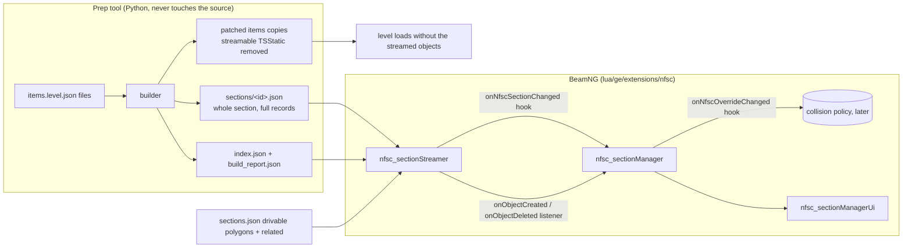

# Palmont section streaming: architecture

Streaming decides which base objects exist. The section manager decides which overrides are
visible. They are two engine extensions with a small interface and can be tested separately.

## Streamer (`nfsc_sectionStreamer`)
- Camera X/Y -> section: bounding box + ray cast against drivable polygons, else closest edge
  within 0.1 (ties to the lower ID), else no section. Outside every section nothing is wanted.
- Wanted set = current section + its `related` sections.
- Entering a section: its whole file is read (current section first) and objects are created from
  a queue (count and millisecond budget per frame). An object in several sections is created once
  (shared `__streamKey`).
- Leaving a section: objects no other active section needs are deleted after the cooldown; coming
  back inside the cooldown cancels the deletion.
- All objects live in one runtime SimGroup, `NFSC_StreamedScenery`, deleted and rebuilt on every
  initialize/reset, so a Lua reload can never leave duplicates behind.
- Transforms are written as exported (`position`, `rotationEuler`, `scale` as space-joined text via
  `setField`, like every other field). Nothing is converted, normalized or moved.
- It never reads `sectionOverrideName` or `instanceFlags` for decisions.

## Manager (`nfsc_sectionManager`) and panel (`nfsc_sectionManagerUi`)
- Listens to the streamer. For every created object with a `sectionOverrideName` it applies the
  current override state before the first render, so nothing pops in and then hides.
- Rule: an object with override names is visible if at least one name is enabled; objects without
  one are untouched. The enabled set exists only at runtime (kept across a Lua reload with
  `onSerialize`). The builder's `index.json` only supplies the static `name -> sections` map used to
  list overrides nearest-first (current section, related sections, the rest).
- Changing an override toggles only the live objects of that override and fires
  `onNfscOverrideChanged(name, enabled)`.
- Instance flags: all 32 are parsed (`M.FLAGS`); the ones the game's draw gate uses are applied
  (main view, game mode, platform, group-disable baseline), the rest are counted. Details and the
  comparison with the game: `docs/FIDELITY.md`.
- Emitters and lights stay in the scene. The manager indexes them by `sectionID` at initialize
  (`rescanScene()`), switches them with section residency, their override names and one On/Off radio
  per class (`setSceneClassEnabled`), and hides emitters beyond their `farClip`. The legacy
  `tsstatic_section_streaming.lua` is no longer loaded.
- Game mode (Freeroam/Racing) and Platform (High/Low) radios feed the flag gate.

## Collision policy (`nfsc_sectionCollision`)
Collision is separate from rendering. A refresh (`be:reloadCollision()`) cannot run asynchronously,
so the policy only decides when to pay for it and measures the cost.
- `off` (default): streamed objects are created with `collisionType None`; separate collision meshes
  in the level keep working as before.
- `settled`: objects keep their exported collision. One refresh happens after the streamer has been
  idle for `settleDelay` seconds and at least `minInterval` seconds after the last refresh, however
  many objects changed. Override changes also schedule one, so hidden objects stop colliding.
- Each refresh is timed (last/max/average ms in `getStatus()` and the panel), so the real hitch cost
  can be read in game before choosing a mode. `setMode("settled", true)` re-streams existing objects.
- Reading the numbers is the point of this step: if a settled refresh is too slow, the next options
  are per-section collision groups or keeping collision meshes resident.

## Interface
| Direction | Name | Kind |
|---|---|---|
| streamer -> all | `onNfscStreamerInitialized()`, `onNfscSectionChanged(new, old)` | `extensions.hook` |
| streamer -> manager | `onObjectCreated(key, obj, item)`, `onObjectDeleted(key)`, `onStreamerReset()` | `addListener` |
| manager -> all | `onNfscOverrideChanged(name, enabled)`, `onNfscSceneClassChanged(kind, on)` | `extensions.hook` |
| streamer -> collision | `onObjectCreated`, `onObjectDeleted`, `onStreamerReset`; `isIdle()` | listener / API |
| any | `getStatus()`, `getFailures()`, `getActiveSections()`, `getCurrentSectionID()` | API |

Per-object events use direct listeners because `extensions.hook` visits every loaded extension.

## BeamNG integration point
Put `lua/ge/extensions/nfsc/*.lua` in the mod zip. `examples/mainLevel_nfsc_extensions.lua` loads
the three extensions, calls `nfsc_sectionStreamer.initialize("levels/nfsc")` and unloads them with
the level. The builder's `runtime/levels/nfsc/lua/` folder (index and sections) and `sections.json`
go next to the level. Copy the builder's patched items files over the level's, since streamed
objects must no longer exist there.

## Diagnostics
`getStatus()` reports current section, active sections, live objects, queued objects and section
reads, pending unloads, created/deleted totals and failure count; `getFailures()` returns the last
20 messages. The panel shows all of it. The first three created objects log an exported-vs-readback
position and scale line.

## Not done / not validated
- Collision: default `off`. The cost of a `settled` refresh in BeamNG is unmeasured; whether it hitches
  is the open question.
- Depth sections (stacked sections) are not in `sections.json`; see `docs/FIDELITY.md`.
- Nothing here has run in BeamNG. To verify: camera tracking, transitions, recreation after
  cooldown, setField behaviour for `rotationEuler`, negative scale and `collisionType`, object counts
  and memory over a long drive, `onDeserialized` (the hook name is assumed), and the imgui calls.
